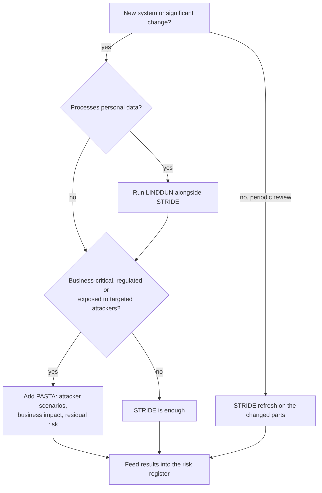

# Choosing a method: STRIDE, PASTA or LINDDUN

You do not have to pick one for life. Most teams use **STRIDE** as the default, add **LINDDUN** when personal data is
involved, and reserve **PASTA** for the handful of systems where the business wants a risk-ranked, attacker-centred
story. Use the table, then the decision tree.

| | STRIDE | PASTA | LINDDUN |
|---|---|---|---|
| **Question it answers** | What can go wrong with each component? | Which realistic attacks would hurt the business most, and are we prepared? | How could this system harm people's privacy? |
| **Lens** | Security properties (per element) | Attacker and business impact | Data subject |
| **Starting artefact** | Data-flow diagram | Business objectives + technical scope | Data-flow diagram with personal-data flows |
| **Output** | Threat list with mitigations | Risk-ranked attack scenarios with countermeasures and residual risk | Privacy threats mapped to mitigation strategies |
| **Typical effort** | Half a day to two days | One to three weeks, several workshops | One to two days, needs privacy/legal input |
| **Best for** | Every new system or significant change; design reviews; CI-friendly | Flagship or regulated systems; preparing a pen-test or red-team scope; board-level risk conversations | Anything that processes personal data: customer apps, HR, analytics, AI trained on user data |
| **Weak spot** | Produces many generic threats; no ranking by itself | Heavy; needs threat-intel and business participation | Does not cover classic security threats |
| **Pairs well with** | OWASP ASVS, ISO 27001 Annex A | MITRE ATT&CK, risk register | GDPR DPIA, ISO 27701, ISO 42001 impact assessment |

## Decision tree

## What "enough" looks like

A threat model is done when:

* the diagram shows every trust boundary crossing and every store of sensitive data;
* every High-priority threat has a decision (mitigate, accept, transfer, avoid) and an owner;
* mitigations are traceable to requirements or backlog items, with a verification method;
* the model has a next-review trigger (date, architecture change, incident, new regulation).

It is not done when it is a 40-page document nobody opens again. Prefer a two-page model that is re-read every quarter.

## Using the three guides

* [`stride-guide.md`](stride-guide.md) — the per-element method, with the generator script.
* [`pasta-guide.md`](pasta-guide.md) — the seven stages, trimmed to what a security team of two can actually run.
* [`linddun-guide.md`](linddun-guide.md) — the seven privacy threat categories and how they map to mitigation strategies.

Templates to copy are in [`../templates/`](../templates/), one per method, and the per-phase checklists are in
[`../checklists/`](../checklists/).
