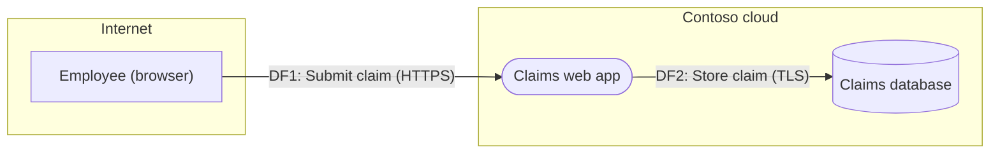

# Data-flow diagram convention (Mermaid)

A threat model is only as good as the picture it starts from. This convention keeps diagrams consistent
across teams, readable in a pull request, and machine-readable by `scripts/stride_from_dfd.py`.

## The four element types and one boundary

| Element | Meaning | Mermaid shape | Example |
|---------|---------|---------------|---------|
| **External entity** | A person or system outside your control that sends or receives data | Rectangle `EE1["Customer"]` | customer, partner API, SaaS provider, staff member |
| **Process** | Code you run that transforms data | Stadium `P1(["Web app"])` | web app, API, batch job, queue consumer, model-serving service |
| **Data store** | Where data rests | Cylinder `DS1[("Orders DB")]` | database, object bucket, cache, log store, vector index |
| **Data flow** | Data moving between two elements | Arrow with label `A -->|"DF1: Login (HTTPS)"| B` | request/response, event, file transfer |
| **Trust boundary** | Where the level of trust changes | `subgraph TB1["Internet"] ... end` | internet / DMZ / app zone / data zone / third party / corporate |

Rules that matter for threat identification:

1. **Every element sits inside exactly one trust boundary.** If you cannot say which, you have not finished decomposing.
2. **Every data flow has an ID, a name, a protocol and a description of the data it carries.** "HTTPS" is a protocol;
   "customer PII" is data. Both are needed to reason about Tampering and Information disclosure.
3. **Flows that cross a boundary are where most threats live.** Draw them explicitly, even when they are internal.
4. **One diagram per level.** Level 0 (context: the system as one process plus its external entities), Level 1
   (main components), Level 2 only for the parts that carry sensitive data or privileged actions.
5. **Mark AI components** (`ai: true`) and training/retrieval data (`training_data: true`) so AI-specific threats are generated.
6. **No secrets, hostnames or IP addresses** in diagrams. Names describe roles ("Payments API"), not infrastructure.

## IDs

| Prefix | Element | Example |
|--------|---------|---------|
| `EE` | External entity | `EE1` |
| `P` | Process | `P4` |
| `DS` | Data store | `DS2` |
| `DF` | Data flow | `DF10` |
| `TB` | Trust boundary | `TB3` |

Threat IDs produced by the generator are `<element id>-<STRIDE letter><n>`, for example `P4-T2` is the second
Tampering threat on process P4. IDs survive when you add elements, which keeps review comments stable.

## YAML schema read by `stride_from_dfd.py`

```yaml
system:
  name: <system name>            # required
  version: "1.0"                 # optional, printed in the report
  owner: <role>                  # optional
  description: <paragraph>       # optional, printed in the report

trust_boundaries:
  - id: TB1
    name: Internet (untrusted)
    description: <optional>

external_entities:
  - id: EE1
    name: Customer (browser)
    boundary: TB1                # must reference a trust boundary id

processes:
  - id: P1
    name: Web application
    boundary: TB2
    technology: <free text>      # optional, printed in the element table
    ai: true                     # optional: adds prompt-injection, leakage, excessive-agency and exhaustion threats

data_stores:
  - id: DS1
    name: Orders database
    boundary: TB3
    classification: Confidential # optional: Confidential/Restricted/Secret raises T and I priority
    personal_data: true          # optional: raises T and I priority
    training_data: true          # optional: adds a data-poisoning threat

data_flows:
  - id: DF1
    name: Login
    from: EE1                    # element id
    to: P1                       # element id
    protocol: HTTPS
    data: credentials, session cookie
    credentials: true            # optional: raises I priority
    personal_data: true          # optional: raises I priority
```

Any extra key on an element is kept and printed in the element table, so you can add `owner`, `hosting` or
`notes` without breaking the tool.

## Minimal example

```yaml
system:
  name: Contoso expense claims
trust_boundaries:
  - {id: TB1, name: Internet}
  - {id: TB2, name: Contoso cloud}
external_entities:
  - {id: EE1, name: Employee (browser), boundary: TB1}
processes:
  - {id: P1, name: Claims web app, boundary: TB2}
data_stores:
  - {id: DS1, name: Claims database, boundary: TB2, classification: Confidential, personal_data: true}
data_flows:
  - {id: DF1, name: Submit claim, from: EE1, to: P1, protocol: HTTPS, data: receipts and bank details, personal_data: true}
  - {id: DF2, name: Store claim, from: P1, to: DS1, protocol: TLS, data: claim records, personal_data: true}
```

Rendered by the tool:



## Drawing by hand

If you draw in a whiteboard tool instead of YAML, keep the same shapes and labels and paste the Mermaid block into the
threat-model template under *2. System decomposition*. GitHub, GitLab and most wikis render Mermaid natively.
