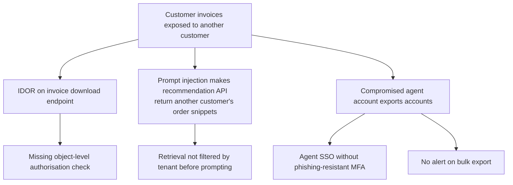

# PASTA guide (Process for Attack Simulation and Threat Analysis)

PASTA is a seven-stage, risk-centred method. It starts from business objectives, ends with residual risk, and in the
middle asks "what would a motivated attacker actually do to this system?". It is heavier than STRIDE; use it for the
systems where the answer changes a budget decision.

This guide trims each stage to what a small security team can run in two to three weeks with four or five workshops.

## Stage overview

| Stage | Question | Main input | Main output | Who |
|-------|----------|-----------|-------------|-----|
| 1. Define objectives | What does the business need this system to protect? | Business case, SLAs, regulations | Security and compliance objectives, impact criteria | Product owner, security |
| 2. Define technical scope | What are we modelling? | Architecture docs, inventory | Scope statement, asset list, dependencies | Architect, security |
| 3. Decompose the application | How does it work? | DFD, code, configs | DFD with trust boundaries, roles and permissions, entry points | Architect, lead dev |
| 4. Analyse threats | Who would attack it and why? | Threat intel, incident history, sector reports | Threat actor profiles, relevant ATT&CK techniques | Security, SOC |
| 5. Analyse vulnerabilities | Where is it weak? | Scan results, pen-test findings, STRIDE table, known CVEs | Weakness list tied to components | Security, dev |
| 6. Model attacks | How would the attack unfold end to end? | Stages 3–5 | Attack trees or kill-chain scenarios | Security, dev, SOC |
| 7. Analyse risk and impact | What do we do about it? | Scenarios, impact criteria | Risk-ranked scenarios, countermeasures, residual risk, decisions | Security, product owner, risk owner |

## Running it

### Stage 1 — Objectives (one workshop, 60 minutes)

Write down, in business language, what a bad day looks like. Three to six statements are enough:

> "Customers must never see each other's invoices." · "The portal must stay available during the month-end peak." ·
> "Recommendations must not be influenced by anyone outside Northwind."

Turn each into an impact criterion with a severity (reuse the 1–5 impact scale from your risk register).

### Stage 2 — Technical scope (desk work)

List the components, data classes, third parties and infrastructure in scope. Say what is out of scope and why.
Capture dependencies you do not control (identity provider, payment provider, model API).

### Stage 3 — Decomposition (one workshop, 90 minutes)

Build the DFD with the [convention](dfd-convention.md). Add two tables STRIDE does not require:

* **Roles and permissions** — who can do what, including service accounts and administrators.
* **Entry points** — every way data enters: UI, API, webhook, file upload, message queue, model prompt.

### Stage 4 — Threat analysis (desk work + 30-minute review)

Profile two to four threat actors that are realistic for this system: motivation, capability, access. Use public
sector reports and your own incidents. Map what they typically do to MITRE ATT&CK technique IDs so the SOC can check
detection coverage later.

| Actor | Motivation | Capability | Likely initial access |
|-------|------------|------------|-----------------------|
| Financially motivated criminal group | Invoice fraud, extortion | Medium–high | Phishing of staff, credential stuffing of customers |
| Competitor-sponsored insider | Pricing data | Low–medium | Legitimate access, exports |
| Opportunistic scanner | Any foothold | Low | Known vulnerabilities on internet-facing components |

### Stage 5 — Vulnerability analysis (desk work)

Collect what is already known: scanner output, pen-test findings, the STRIDE table from the generator, dependency
alerts, misconfigurations. Attach each weakness to a component in the DFD. Resist fixing things yet.

### Stage 6 — Attack modelling (one workshop, 2 hours)

For each actor, build two or three end-to-end scenarios that reach an impact from Stage 1. Attack trees work well:
root = the impact, branches = alternative ways to get there, leaves = concrete steps that need a weakness from Stage 5.

Mark which leaves are already blocked by a control, and how you know.

### Stage 7 — Risk and impact (one workshop, 90 minutes)

Score each scenario: likelihood (actor capability × ease given current weaknesses) × impact (from Stage 1 criteria).
Propose countermeasures per scenario, estimate residual risk, and get a decision from the risk owner. Copy the result
into the organisation's risk register so it is reviewed with everything else.

## Deliverable

The [PASTA template](../templates/threat-model-pasta.md) has one section per stage. Keep it to 6–10 pages: objectives,
scope, DFD, actor table, scenario list with attack trees, risk table with decisions. Attach the STRIDE table as an
appendix rather than pasting it.

## Common mistakes

* Starting at Stage 6 because attack trees are fun. Without Stage 1 you cannot rank anything.
* Modelling nation-state actors for a logistics portal. Pick actors that would plausibly spend time on *this* system.
* Treating PASTA as a one-off. Re-run Stages 4–7 after a major incident in your sector or a significant change.
