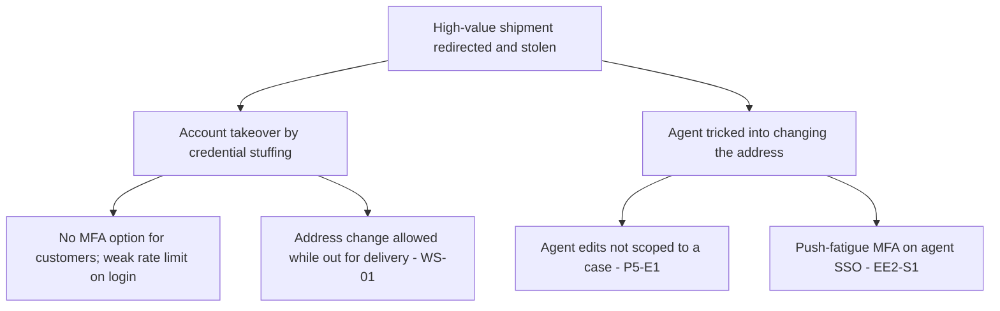

# Worked example — Northwind Logistics customer portal and AI recommendation API

Everything here is fictional. The example shows the full path: scoping, decomposition, generated STRIDE table,
workshop pruning, PASTA attack scenarios, LINDDUN privacy threats, decisions and validation. Copy the structure, not
the content.

| | |
|---|---|
| **Model ID** | TM-014 |
| **System / version** | Northwind customer portal 1.2 (adds the LLM-based recommendation API) |
| **System owner (role)** | Head of Digital Platforms |
| **Participants (roles)** | Security lead (facilitator), platform architect, portal tech lead, data science lead, product owner, privacy officer (LINDDUN session) |
| **Date / status** | 2026-10-20 · Reviewed |
| **Trigger** | Significant change: new AI component sending customer data to a third-party model provider |
| **Next review** | 2027-04-20 or before the recommendation API gains write actions |

## 1. Scope and objectives

**In scope:** public portal (gateway, web application), shipment service, recommendation API and its knowledge
index, customer database, admin console used by customer-service agents, audit logging, the third-party model API
as an external entity, the carrier webhook as an external entity.

**Out of scope:** corporate identity provider (TM-003), carrier partners' own systems, the nightly index-build job
(covered in TM-015 — data pipeline), payment provider (not integrated in 1.2).

**Crown jewels:** customer and order database (contacts, addresses, invoices); the integrity of shipment status; the
content of prompts sent to the model provider.

**Compliance context:** personal data of EU and UK business contacts; ISO/IEC 27001 certified scope includes the
portal; ISO/IEC 42001 programme in progress — the recommendation API needs an AI system impact assessment; EU AI Act
preliminary classification: limited-risk (transparency duty: users must know they interact with an AI feature).

Security objectives:

1. A customer must never see another customer's shipments, invoices or support history — including through the recommendation feature.
2. The portal must stay available during the month-end invoicing peak.
3. Shipment status shown to customers must reflect genuine carrier events.
4. Customer-service agents' actions must be attributable and limited to the accounts they are handling.
5. Personal data sent to the model provider must be minimised and never retained by the provider.

## 2. Decomposition

The model is in [`northwind-portal.yaml`](northwind-portal.yaml); the generated diagram and element tables are in
[`northwind-portal/stride-threats.md`](northwind-portal/stride-threats.md). Six trust boundaries, 4 external entities,
5 processes, 4 data stores, 14 flows — 12 of them cross a boundary.

Entry points:

| ID | Entry point | Authenticated? | Data accepted |
|----|-------------|----------------|---------------|
| DF1 | Portal UI and REST API via gateway | Yes (customer credentials, session) | Credentials, invoice and shipment queries, delivery preferences, free-text questions to the recommender |
| DF6 | Carrier webhook | Shared secret per carrier | Scan events |
| DF11 | Admin console | SSO + MFA | Customer search, delivery edits |
| DF10 (return path) | Model completion | Provider API key | Model text, which the recommendation API renders to customers |

Roles: customer (own account), agent (any account, read + delivery edits), platform admin (deploy, config), service
identities (gateway → web app → services), batch index builder (write to DS3, out of scope).

## 3. Threat identification

### 3.1 Generated baseline

`python scripts/stride_from_dfd.py examples/northwind-portal.yaml --out examples/northwind-portal` produced
**101 threats**, 63 marked High. Full table: [`northwind-portal/stride-threats.md`](northwind-portal/stride-threats.md)
and [`northwind-portal/stride-threats.csv`](northwind-portal/stride-threats.csv).

### 3.2 Workshop result (90 minutes, High threats only)

The team merged and pruned the baseline to 14 threats worth tracking, and added 4 the generator could not see.
Scores use the organisation's 1–5 scales (Likelihood × Impact).

| Threat ID | Element | STRIDE | Threat | L | I | Score | Band | Decision |
|-----------|---------|--------|--------|---|---|-------|------|----------|
| P2-E1 | Portal web app | E | Invoice download endpoint checks authentication but not that the invoice belongs to the session's customer (IDOR) | 4 | 4 | 16 | High | Mitigate |
| P4-T2 | Recommendation API | T (prompt injection) | A customer writes instructions in a support ticket; the ticket is retrieved into the prompt and makes the model output other customers' order snippets | 3 | 5 | 15 | High | Mitigate |
| P4-I2 | Recommendation API | I (leakage) | Retrieval over DS3 is not filtered by customer ID before the prompt is built; a well-phrased question returns another customer's data | 4 | 5 | 20 | Critical | Mitigate (interim control now) |
| DF10-I1 | Prompt and completion | I | Prompts containing names, addresses and ticket text go to the provider; retention terms not yet confirmed | 4 | 4 | 16 | High | Mitigate |
| P4-D2 | Recommendation API | D (exhaustion) | Unbounded free-text questions and no per-customer quota; a scripted client can spend the monthly model budget in a day | 4 | 3 | 12 | High | Mitigate |
| DS3-T2 | Knowledge index | T (poisoning) | Ticket text written by customers lands in the index unreviewed; crafted tickets steer recommendations for all customers | 2 | 4 | 8 | Medium | Mitigate (next cycle) |
| EE4-S1 | Carrier feed | S | A single shared secret per carrier, never rotated; a leaked secret allows fake "delivered" events | 3 | 4 | 12 | High | Mitigate |
| P1-D1 | API gateway | D | Month-end peak plus a volumetric attack exceeds the gateway's rate-limit design | 3 | 4 | 12 | High | Transfer (provider DDoS tier) + Mitigate |
| EE2-S1 / P5-S1 | Agent / admin console | S | Agent SSO uses push MFA; push fatigue phishing has hit the sector | 3 | 4 | 12 | High | Mitigate |
| P5-E1 | Admin console | E | Agents can edit any account; no case-based scoping, no alert on bulk edits | 3 | 4 | 12 | High | Mitigate |
| DS1-I1 | Customer DB | I | Storage encrypted, but nightly exports to the analytics bucket are unencrypted and readable by all data engineers | 3 | 4 | 12 | High | Mitigate |
| DF1-I1 | Browse / log in | I | Invoice PDFs served from a signed URL that does not expire for 7 days; links are forwarded by e-mail | 3 | 3 | 9 | Medium | Mitigate |
| DS4-T1 | Audit log store | T | Audit store is append-only via API but the platform admin role can delete the bucket | 2 | 4 | 8 | Medium | Mitigate |
| P3-R1 | Shipment service | R | Carrier events are logged without the originating carrier identity | 3 | 2 | 6 | Medium | Mitigate |

Workshop-added threats:

| Threat ID | Element | Threat | L | I | Score | Band | Decision |
|-----------|---------|--------|---|---|-------|------|----------|
| WS-01 | P2 | "Change delivery address" feature can be used on a shipment already out for delivery, enabling parcel theft after an account takeover | 3 | 4 | 12 | High | Mitigate |
| WS-02 | P4 | Model output is rendered as HTML in the portal; a completion containing markup leads to stored XSS | 3 | 3 | 9 | Medium | Mitigate |
| WS-03 | P4 | The model confidently invents delivery promises ("guaranteed by Friday") that create contractual exposure | 4 | 3 | 12 | High | Mitigate |
| WS-04 | P5 | Agents export account lists to spreadsheets for "convenience"; exports are not logged | 3 | 3 | 9 | Medium | Mitigate |

Deleted with reason (examples): all internal flow Tampering threats on DF2/DF4/DF7/DF8 — service mesh enforces mTLS
and the mesh is in TM-003's scope; DS4-D1 — the audit store has cross-region replication with tested restores.

## 4. Mitigation plan

| # | Requirement (verifiable) | Covers | ASVS 5.0 | ISO 27001 A | ISO 42001 A | Verification | Due |
|---|--------------------------|--------|----------|-------------|-------------|--------------|-----|
| 1 | Object-level authorisation on every customer-data endpoint through shared middleware; negative tests in CI | P2-E1, WS-01 | V8, V4 | A.5.15, A.8.3 | — | Automated tests + pen-test retest | 30 days |
| 2 | Retrieval filtered by customer ID *before* ranking; prompt assembled only from the requesting customer's data; tenant-isolation test suite | P4-I2 | V8, V4, V14 | A.8.3, A.5.33 | A.6.2.4, A.7.4 | Test suite + red-team prompts | Interim: feature disabled for ticket data within 24 h; full fix 30 days |
| 3 | Ticket text passed to the model as quoted data, not instructions; output constrained to a JSON schema; adversarial prompt test set run before each release | P4-T2, WS-02, WS-03 | V1, V2, V4, V15 | A.8.26, A.8.28, A.8.29 | A.6.2.4, A.6.2.6 | Release gate | 60 days |
| 4 | Pseudonymise names and addresses before prompting; zero-retention clause and regional processing confirmed in the provider contract; prompt logs redacted | DF10-I1 | V14, V12 | A.5.19, A.5.20, A.5.34, A.8.12 | A.7.5, A.10.3 | Contract on file + log sample review | 60 days |
| 5 | Per-customer and global token quotas, maximum question length, spend alert at 70 % of monthly budget, graceful fallback to static suggestions | P4-D2 | V4, V13 | A.8.6, A.8.16 | A.6.2.6 | Config check + load test | 30 days |
| 6 | Model output rendered as text only; disclosure label "AI-generated suggestion, not a commitment" on every recommendation | WS-02, WS-03 | V3, V1 | A.8.28 | A.8.2, A.9.4 | UI review | 30 days |
| 7 | Per-carrier signed webhooks (HMAC with rotation every 90 days); event source recorded in the audit log | EE4-S1, P3-R1 | V4, V6, V16 | A.5.17, A.8.15 | — | Config check | 90 days |
| 8 | Phishing-resistant MFA (FIDO2) for agents; account edits scoped to open cases; alert on more than 20 edits or any export per agent per hour | EE2-S1, P5-E1, WS-04 | V6, V8, V16 | A.5.17, A.8.2, A.8.5, A.8.15, A.8.16 | — | IdP policy export + SIEM rule ID | 90 days |
| 9 | Encrypt analytics exports with a key the data team cannot read without approval; drop direct identifiers from the export | DS1-I1 | V11, V14 | A.8.11, A.8.24, A.8.12 | — | Bucket policy + sample | 60 days |
| 10 | Signed invoice URLs expire after 15 minutes and are bound to the session | DF1-I1 | V7, V14 | A.8.12 | — | Code review | 30 days |
| 11 | Audit bucket protected by retention lock; platform admin cannot delete within the retention period | DS4-T1 | V16, V13 | A.8.15, A.8.17 | — | Config check | 60 days |
| 12 | Upgrade to the provider's DDoS protection tier; peak-load test at 3× month-end traffic | P1-D1 | V13 | A.8.6, A.8.14 | — | Load-test report | 90 days |
| 13 | Review queue for customer-authored text before it enters the knowledge index; index rebuilt from a signed snapshot | DS3-T2 | V5, V8 | A.8.9, A.8.32, A.5.33 | A.7.4, A.7.5 | Pipeline config | Next cycle |

## 5. PASTA extract (Stages 4, 6, 7)

The product owner asked for an attacker-centred view before approving the launch. Two actors were profiled:

| Actor | Motivation | Capability | Likely techniques |
|-------|------------|------------|-------------------|
| Financially motivated group running parcel-redirection fraud | Steal high-value shipments | Medium: credential stuffing, phishing, scripting | T1110.004 (credential stuffing), T1566 (phishing), abuse of the address-change feature |
| Curious competitor's analyst with a legitimate customer account | Learn Northwind's customers and volumes | Low: uses the product as designed, with persistence | Prompt manipulation of the recommender, enumeration of invoice IDs |

Scenario S1 — parcel redirection after account takeover:

Scenario S2 — cross-customer data harvesting through the recommender: P4-I2 then P4-T2, automated with a script,
undetected because recommendation queries are not rate-limited (P4-D2) and not logged with the retrieved document IDs.

| Scenario | L | I | Score | Countermeasures (plan #) | Residual L | Residual I | Residual | Decision |
|----------|---|---|-------|--------------------------|------------|------------|----------|----------|
| S1 | 4 | 4 | 16 High | 1, 8, plus customer MFA option (added to roadmap) | 2 | 4 | 8 Medium | Mitigate |
| S2 | 4 | 5 | 20 Critical | 2, 3, 5, plus logging of retrieved document IDs per request | 1 | 5 | 5 Medium | Mitigate — interim control applied |

Both scenarios entered the enterprise risk register as R-021 and R-022 with the model ID as reference.

## 6. LINDDUN extract

The privacy officer ran a one-hour LINDDUN pass on flows DF8, DF9, DF10 and store DS3.

| ID | Element | Category | Threat | Subjects | L | Severity | Score | Strategy | Technique |
|----|---------|----------|--------|----------|---|----------|-------|----------|-----------|
| PT-01 | DF10 | Data disclosure | Contact names, addresses and ticket text leave the organisation to the model provider | Customer contacts | 4 | 4 | 16 | Hide / Minimise | Pseudonymisation before prompting; zero-retention contract (plan #4) |
| PT-02 | DS3 | Non-compliance | Support tickets collected for service are reused to generate commercial recommendations — a purpose not stated in the privacy notice | Customer contacts | 4 | 3 | 12 | Inform / Enforce | Update notice; purpose tag on index content; exclude tickets flagged sensitive |
| PT-03 | P4 | Unawareness | Customers are not told that suggestions are AI-generated from their history, and cannot opt out | Customer contacts | 5 | 2 | 10 | Inform / Control | Disclosure label (plan #6); opt-out toggle in preferences |
| PT-04 | P4 | Linking | The recommender links order history, ticket sentiment and browsing context into a per-contact profile not previously held | Customer contacts | 3 | 3 | 9 | Separate / Abstract | No persisted profile; context assembled per request and discarded |
| PT-05 | DS3 | Identifying | Ticket text includes personal remarks about named drivers and recipients | Drivers, recipients | 3 | 3 | 9 | Minimise | Strip free-text ticket bodies from the index; keep structured fields |

A DPIA was deemed required (systematic profiling of contacts using a novel technology). The findings also feed the
ISO/IEC 42001 impact assessment for the recommendation API (clause 6.1.4; Annex A.5.4, A.7.2, A.7.3).

## 7. Validation record

| Date | What was checked | Method | Result | Model updated? |
|------|------------------|--------|--------|----------------|
| 2026-10-21 | Interim control: ticket data removed from retrieval | Config review + prompt test | Pass | Yes (DS3 description) |
| 2026-11-05 | Plan #1 object-level authorisation | 42 negative tests in CI; pen-test retest of 6 endpoints | Pass | — |
| 2026-11-12 | Plan #2 tenant isolation | 300 cross-tenant prompts from the red-team set; 0 leaks | Pass | Residual P4-I2 re-scored 1×5 |
| 2026-11-20 | Plan #5 quotas and spend alert | Load test at 50 req/s per account; alert fired at 70 % | Pass | — |
| 2026-12-02 | Plan #8 FIDO2 for agents | IdP policy export; 100 % of agent accounts enrolled | Pass | Residual EE2-S1 re-scored 1×4 |

Open at review date: plans #3, #4, #7, #9, #11, #12, #13 (all within due dates).

## 8. Sign-off

| Role | Decision | Date |
|------|----------|------|
| Head of Digital Platforms | Launch approved with interim control; plans tracked in the risk register | 2026-10-22 |
| Security lead | Reviewed | 2026-10-22 |
| Privacy officer | DPIA opened; launch conditional on plan #4 and #6 | 2026-10-22 |

## What to take from this example

* The generator found the two threats that mattered most (P4-I2, P4-T2) — but only because the model marked the
  recommendation API `ai: true` and the index `training_data: true`.
* The workshop found the one that would have caused the first real loss (WS-01, address change in transit). Always run the workshop.
* Three documents (STRIDE, PASTA, LINDDUN) share one diagram and one set of IDs. That is what keeps the exercise under a week.
