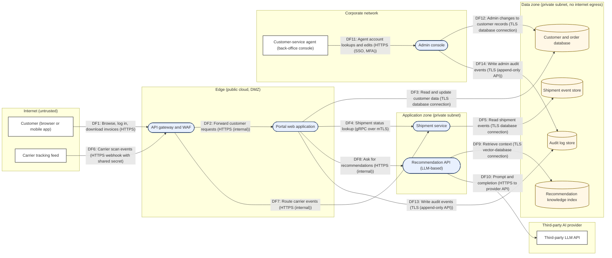

# STRIDE threat table — Northwind Logistics customer portal

Generated by `scripts/stride_from_dfd.py` from `northwind-portal.yaml` (model version 1.2). Do not edit by hand — change the YAML and regenerate.

Fictional customer-facing portal where Northwind Logistics customers track shipments, download invoices and manage delivery preferences. A recommendation API, built on a third-party large language model, suggests delivery slots and add-on services from the customer's order history and support tickets.

## Summary

| Item | Count |
|------|-------|
| External entities | 4 |
| Processes | 5 |
| Data stores | 4 |
| Data flows | 14 |
| Data flows crossing a trust boundary | 12 |
| Trust boundaries | 6 |
| Threats generated | 101 |
| Threats marked High priority | 63 |

## Data-flow diagram

## Elements

| ID | Type | Name | Trust boundary | Attributes |
|----|------|------|----------------|------------|
| EE1 | External entity | Customer (browser or mobile app) | Internet (untrusted) |  |
| EE2 | External entity | Customer-service agent (back-office console) | Corporate network |  |
| EE3 | External entity | Third-party LLM API | Third-party AI provider |  |
| EE4 | External entity | Carrier tracking feed | Internet (untrusted) |  |
| P1 | Process | API gateway and WAF | Edge (public cloud, DMZ) | technology=Managed gateway with WAF rules, TLS termination, rate limiting. |
| P2 | Process | Portal web application | Edge (public cloud, DMZ) | technology=Server-rendered web app plus REST API (customer sessions, invoices, preferences). |
| P3 | Process | Shipment service | Application zone (private subnet) | technology=Internal microservice; owns shipment status and carrier events. |
| P4 | Process | Recommendation API (LLM-based) | Application zone (private subnet) | ai=true, technology=Retrieval-augmented service that builds prompts from order history and tickets and calls the external model. |
| P5 | Process | Admin console | Corporate network | technology=Internal web application for customer-service agents; SSO with MFA. |
| DS1 | Data store | Customer and order database | Data zone (private subnet, no internet egress) | classification=Confidential, personal_data=true |
| DS2 | Data store | Shipment event store | Data zone (private subnet, no internet egress) | classification=Internal, personal_data=true |
| DS3 | Data store | Recommendation knowledge index | Data zone (private subnet, no internet egress) | classification=Confidential, personal_data=true, training_data=true |
| DS4 | Data store | Audit log store | Data zone (private subnet, no internet egress) | classification=Internal |

| ID | Data flow | From | To | Protocol | Data | Crosses boundary |
|----|-----------|------|----|----------|------|------------------|
| DF1 | Browse, log in, download invoices | EE1 | P1 | HTTPS | credentials, session cookie, invoice requests | yes |
| DF2 | Forward customer requests | P1 | P2 | HTTPS (internal) | authenticated requests with user identity header | no |
| DF3 | Read and update customer data | P2 | DS1 | TLS database connection | account, address, invoice and preference records | yes |
| DF4 | Shipment status lookup | P2 | P3 | gRPC over mTLS | consignment identifiers, status | yes |
| DF5 | Read shipment events | P3 | DS2 | TLS database connection | scan events, delivery addresses | yes |
| DF6 | Carrier scan events | EE4 | P1 | HTTPS webhook with shared secret | consignment id, timestamp, location, status | yes |
| DF7 | Route carrier events | P1 | P3 | HTTPS (internal) | scan events | yes |
| DF8 | Ask for recommendations | P2 | P4 | HTTPS (internal) | customer id, current page context, free-text question | yes |
| DF9 | Retrieve context | P4 | DS3 | TLS vector-database connection | embeddings query, matching order and ticket snippets | yes |
| DF10 | Prompt and completion | P4 | EE3 | HTTPS to provider API | prompt with retrieved snippets, model completion | yes |
| DF11 | Agent account lookups and edits | EE2 | P5 | HTTPS (SSO, MFA) | staff credentials, customer search, delivery edits | no |
| DF12 | Admin changes to customer records | P5 | DS1 | TLS database connection | account and delivery edits | yes |
| DF13 | Write audit events | P2 | DS4 | TLS (append-only API) | authentication, authorisation and data-change events | yes |
| DF14 | Write admin audit events | P5 | DS4 | TLS (append-only API) | staff actions on customer records | yes |

## Threats

Priority is a starting point, not a verdict: High = the element is reachable across a trust boundary or holds sensitive data, or the threat is AI-specific. Rate likelihood and impact yourself in the threat-model template, then decide mitigate / accept / transfer / avoid.

| Threat ID | Element | Type | STRIDE | Priority | Threat | Suggested mitigation | ASVS 5.0 | ISO 27001 Annex A |
|-----------|---------|------|--------|----------|--------|----------------------|----------|-------------------|
| EE1-S1 | Customer (browser or mobile app) | External entity | S — Spoofing | High | Someone or something pretends to be Customer (browser or mobile app) (stolen credentials, replayed token, forged client) and obtains the access that Customer (browser or mobile app) legitimately has. | Authenticate Customer (browser or mobile app) with a method proportionate to what it can reach: MFA for people, mutual TLS or signed requests for systems; rotate and revoke credentials; detect impossible-travel and credential-stuffing patterns. | V6 V7 V12 | A.5.16 A.5.17 A.8.5 A.8.16 |
| EE1-R1 | Customer (browser or mobile app) | External entity | R — Repudiation | Medium | Customer (browser or mobile app) later denies having sent a request or taken an action, and the system cannot prove otherwise. | Log security-relevant actions of Customer (browser or mobile app) with an identity, timestamp and request identifier; protect the logs from modification; keep them for the period your policy requires. | V16 | A.5.33 A.8.15 A.8.17 |
| EE2-S1 | Customer-service agent (back-office console) | External entity | S — Spoofing | Medium | Someone or something pretends to be Customer-service agent (back-office console) (stolen credentials, replayed token, forged client) and obtains the access that Customer-service agent (back-office console) legitimately has. | Authenticate Customer-service agent (back-office console) with a method proportionate to what it can reach: MFA for people, mutual TLS or signed requests for systems; rotate and revoke credentials; detect impossible-travel and credential-stuffing patterns. | V6 V7 V12 | A.5.16 A.5.17 A.8.5 A.8.16 |
| EE2-R1 | Customer-service agent (back-office console) | External entity | R — Repudiation | Medium | Customer-service agent (back-office console) later denies having sent a request or taken an action, and the system cannot prove otherwise. | Log security-relevant actions of Customer-service agent (back-office console) with an identity, timestamp and request identifier; protect the logs from modification; keep them for the period your policy requires. | V16 | A.5.33 A.8.15 A.8.17 |
| EE3-S1 | Third-party LLM API | External entity | S — Spoofing | High | Someone or something pretends to be Third-party LLM API (stolen credentials, replayed token, forged client) and obtains the access that Third-party LLM API legitimately has. | Authenticate Third-party LLM API with a method proportionate to what it can reach: MFA for people, mutual TLS or signed requests for systems; rotate and revoke credentials; detect impossible-travel and credential-stuffing patterns. | V6 V7 V12 | A.5.16 A.5.17 A.8.5 A.8.16 |
| EE3-R1 | Third-party LLM API | External entity | R — Repudiation | Medium | Third-party LLM API later denies having sent a request or taken an action, and the system cannot prove otherwise. | Log security-relevant actions of Third-party LLM API with an identity, timestamp and request identifier; protect the logs from modification; keep them for the period your policy requires. | V16 | A.5.33 A.8.15 A.8.17 |
| EE4-S1 | Carrier tracking feed | External entity | S — Spoofing | High | Someone or something pretends to be Carrier tracking feed (stolen credentials, replayed token, forged client) and obtains the access that Carrier tracking feed legitimately has. | Authenticate Carrier tracking feed with a method proportionate to what it can reach: MFA for people, mutual TLS or signed requests for systems; rotate and revoke credentials; detect impossible-travel and credential-stuffing patterns. | V6 V7 V12 | A.5.16 A.5.17 A.8.5 A.8.16 |
| EE4-R1 | Carrier tracking feed | External entity | R — Repudiation | Medium | Carrier tracking feed later denies having sent a request or taken an action, and the system cannot prove otherwise. | Log security-relevant actions of Carrier tracking feed with an identity, timestamp and request identifier; protect the logs from modification; keep them for the period your policy requires. | V16 | A.5.33 A.8.15 A.8.17 |
| P1-S1 | API gateway and WAF | Process | S — Spoofing | High | A rogue component impersonates API gateway and WAF to its callers or data stores, or API gateway and WAF accepts a caller it has not properly identified. | Give API gateway and WAF its own workload identity (managed identity, mTLS certificate or signed service token); verify the identity of every caller and every downstream service it talks to; never share credentials between components. | V6 V9 V12 | A.5.16 A.8.5 A.8.24 |
| P1-T1 | API gateway and WAF | Process | T — Tampering | High | Input to API gateway and WAF is crafted to change its behaviour (injection, parameter manipulation, business-logic abuse) or its code and configuration are modified without authorisation. | Validate and encode all input at the boundary of API gateway and WAF; use parameterised queries and safe APIs; sign or hash deployed artefacts; manage configuration as code with reviewed changes. | V1 V2 V13 V15 | A.8.9 A.8.26 A.8.28 A.8.32 |
| P1-R1 | API gateway and WAF | Process | R — Repudiation | Medium | Actions performed through API gateway and WAF cannot be attributed to a user or a calling system afterwards. | Emit audit events from API gateway and WAF for authentication, authorisation decisions and data changes, including the caller identity and a correlation ID; forward them to central, append-only logging. | V16 | A.8.15 A.8.17 |
| P1-I1 | API gateway and WAF | Process | I — Information disclosure | Medium | API gateway and WAF reveals more than it should: verbose errors, debug endpoints, secrets in configuration, or responses containing data the caller is not entitled to see. | Return generic error messages from API gateway and WAF; disable debug features in production; keep secrets in a vault, not in code or environment files; filter responses to the minimum fields the caller needs. | V8 V13 V14 V16 | A.8.3 A.8.9 A.8.11 A.8.12 |
| P1-D1 | API gateway and WAF | Process | D — Denial of service | High | API gateway and WAF is overwhelmed or crashed by a flood of requests, expensive operations or malformed input, making the service unavailable. | Rate-limit and size-limit requests to API gateway and WAF; set time-outs on every downstream call; autoscale with an upper bound; test failure modes; monitor saturation and alert. | V4 V13 | A.8.6 A.8.14 A.8.16 |
| P1-E1 | API gateway and WAF | Process | E — Elevation of privilege | High | A caller of API gateway and WAF performs an action or reaches data beyond its role, or API gateway and WAF itself runs with more privilege than its function needs. | Enforce authorisation on every request inside API gateway and WAF (object level and function level); run API gateway and WAF under a least-privilege identity; separate administrative interfaces from user-facing ones. | V4 V8 | A.5.15 A.5.18 A.8.2 A.8.3 |
| P2-S1 | Portal web application | Process | S — Spoofing | Medium | A rogue component impersonates Portal web application to its callers or data stores, or Portal web application accepts a caller it has not properly identified. | Give Portal web application its own workload identity (managed identity, mTLS certificate or signed service token); verify the identity of every caller and every downstream service it talks to; never share credentials between components. | V6 V9 V12 | A.5.16 A.8.5 A.8.24 |
| P2-T1 | Portal web application | Process | T — Tampering | Medium | Input to Portal web application is crafted to change its behaviour (injection, parameter manipulation, business-logic abuse) or its code and configuration are modified without authorisation. | Validate and encode all input at the boundary of Portal web application; use parameterised queries and safe APIs; sign or hash deployed artefacts; manage configuration as code with reviewed changes. | V1 V2 V13 V15 | A.8.9 A.8.26 A.8.28 A.8.32 |
| P2-R1 | Portal web application | Process | R — Repudiation | Medium | Actions performed through Portal web application cannot be attributed to a user or a calling system afterwards. | Emit audit events from Portal web application for authentication, authorisation decisions and data changes, including the caller identity and a correlation ID; forward them to central, append-only logging. | V16 | A.8.15 A.8.17 |
| P2-I1 | Portal web application | Process | I — Information disclosure | Medium | Portal web application reveals more than it should: verbose errors, debug endpoints, secrets in configuration, or responses containing data the caller is not entitled to see. | Return generic error messages from Portal web application; disable debug features in production; keep secrets in a vault, not in code or environment files; filter responses to the minimum fields the caller needs. | V8 V13 V14 V16 | A.8.3 A.8.9 A.8.11 A.8.12 |
| P2-D1 | Portal web application | Process | D — Denial of service | Medium | Portal web application is overwhelmed or crashed by a flood of requests, expensive operations or malformed input, making the service unavailable. | Rate-limit and size-limit requests to Portal web application; set time-outs on every downstream call; autoscale with an upper bound; test failure modes; monitor saturation and alert. | V4 V13 | A.8.6 A.8.14 A.8.16 |
| P2-E1 | Portal web application | Process | E — Elevation of privilege | Medium | A caller of Portal web application performs an action or reaches data beyond its role, or Portal web application itself runs with more privilege than its function needs. | Enforce authorisation on every request inside Portal web application (object level and function level); run Portal web application under a least-privilege identity; separate administrative interfaces from user-facing ones. | V4 V8 | A.5.15 A.5.18 A.8.2 A.8.3 |
| P3-S1 | Shipment service | Process | S — Spoofing | High | A rogue component impersonates Shipment service to its callers or data stores, or Shipment service accepts a caller it has not properly identified. | Give Shipment service its own workload identity (managed identity, mTLS certificate or signed service token); verify the identity of every caller and every downstream service it talks to; never share credentials between components. | V6 V9 V12 | A.5.16 A.8.5 A.8.24 |
| P3-T1 | Shipment service | Process | T — Tampering | High | Input to Shipment service is crafted to change its behaviour (injection, parameter manipulation, business-logic abuse) or its code and configuration are modified without authorisation. | Validate and encode all input at the boundary of Shipment service; use parameterised queries and safe APIs; sign or hash deployed artefacts; manage configuration as code with reviewed changes. | V1 V2 V13 V15 | A.8.9 A.8.26 A.8.28 A.8.32 |
| P3-R1 | Shipment service | Process | R — Repudiation | Medium | Actions performed through Shipment service cannot be attributed to a user or a calling system afterwards. | Emit audit events from Shipment service for authentication, authorisation decisions and data changes, including the caller identity and a correlation ID; forward them to central, append-only logging. | V16 | A.8.15 A.8.17 |
| P3-I1 | Shipment service | Process | I — Information disclosure | Medium | Shipment service reveals more than it should: verbose errors, debug endpoints, secrets in configuration, or responses containing data the caller is not entitled to see. | Return generic error messages from Shipment service; disable debug features in production; keep secrets in a vault, not in code or environment files; filter responses to the minimum fields the caller needs. | V8 V13 V14 V16 | A.8.3 A.8.9 A.8.11 A.8.12 |
| P3-D1 | Shipment service | Process | D — Denial of service | High | Shipment service is overwhelmed or crashed by a flood of requests, expensive operations or malformed input, making the service unavailable. | Rate-limit and size-limit requests to Shipment service; set time-outs on every downstream call; autoscale with an upper bound; test failure modes; monitor saturation and alert. | V4 V13 | A.8.6 A.8.14 A.8.16 |
| P3-E1 | Shipment service | Process | E — Elevation of privilege | High | A caller of Shipment service performs an action or reaches data beyond its role, or Shipment service itself runs with more privilege than its function needs. | Enforce authorisation on every request inside Shipment service (object level and function level); run Shipment service under a least-privilege identity; separate administrative interfaces from user-facing ones. | V4 V8 | A.5.15 A.5.18 A.8.2 A.8.3 |
| P4-S1 | Recommendation API (LLM-based) | Process | S — Spoofing | High | A rogue component impersonates Recommendation API (LLM-based) to its callers or data stores, or Recommendation API (LLM-based) accepts a caller it has not properly identified. | Give Recommendation API (LLM-based) its own workload identity (managed identity, mTLS certificate or signed service token); verify the identity of every caller and every downstream service it talks to; never share credentials between components. | V6 V9 V12 | A.5.16 A.8.5 A.8.24 |
| P4-T1 | Recommendation API (LLM-based) | Process | T — Tampering | High | Input to Recommendation API (LLM-based) is crafted to change its behaviour (injection, parameter manipulation, business-logic abuse) or its code and configuration are modified without authorisation. | Validate and encode all input at the boundary of Recommendation API (LLM-based); use parameterised queries and safe APIs; sign or hash deployed artefacts; manage configuration as code with reviewed changes. | V1 V2 V13 V15 | A.8.9 A.8.26 A.8.28 A.8.32 |
| P4-R1 | Recommendation API (LLM-based) | Process | R — Repudiation | Medium | Actions performed through Recommendation API (LLM-based) cannot be attributed to a user or a calling system afterwards. | Emit audit events from Recommendation API (LLM-based) for authentication, authorisation decisions and data changes, including the caller identity and a correlation ID; forward them to central, append-only logging. | V16 | A.8.15 A.8.17 |
| P4-I1 | Recommendation API (LLM-based) | Process | I — Information disclosure | Medium | Recommendation API (LLM-based) reveals more than it should: verbose errors, debug endpoints, secrets in configuration, or responses containing data the caller is not entitled to see. | Return generic error messages from Recommendation API (LLM-based); disable debug features in production; keep secrets in a vault, not in code or environment files; filter responses to the minimum fields the caller needs. | V8 V13 V14 V16 | A.8.3 A.8.9 A.8.11 A.8.12 |
| P4-D1 | Recommendation API (LLM-based) | Process | D — Denial of service | High | Recommendation API (LLM-based) is overwhelmed or crashed by a flood of requests, expensive operations or malformed input, making the service unavailable. | Rate-limit and size-limit requests to Recommendation API (LLM-based); set time-outs on every downstream call; autoscale with an upper bound; test failure modes; monitor saturation and alert. | V4 V13 | A.8.6 A.8.14 A.8.16 |
| P4-E1 | Recommendation API (LLM-based) | Process | E — Elevation of privilege | High | A caller of Recommendation API (LLM-based) performs an action or reaches data beyond its role, or Recommendation API (LLM-based) itself runs with more privilege than its function needs. | Enforce authorisation on every request inside Recommendation API (LLM-based) (object level and function level); run Recommendation API (LLM-based) under a least-privilege identity; separate administrative interfaces from user-facing ones. | V4 V8 | A.5.15 A.5.18 A.8.2 A.8.3 |
| P4-T2 | Recommendation API (LLM-based) | Process | T — Tampering | High | Prompt injection: instructions hidden in user input or in content retrieved by Recommendation API (LLM-based) (documents, web pages, tool results) change what the model does, bypassing the intended task. | Treat all model input as untrusted; separate system instructions from user content; constrain the model's tools and output format; filter and test with adversarial prompts before and after release. | V1 V2 V4 V15 | A.8.26 A.8.28 A.8.29 A.8.16 |
| P4-I2 | Recommendation API (LLM-based) | Process | I — Information disclosure | High | Model or prompt leakage: Recommendation API (LLM-based) reveals its system prompt, retrieved documents from other tenants, or memorised training data; repeated queries allow the model to be extracted. | Apply tenant and user authorisation to retrieval before the model sees the data; redact personal data in prompts and logs; rate-limit and monitor query patterns; do not put secrets in prompts. | V4 V8 V14 V16 | A.5.33 A.8.3 A.8.12 A.8.16 |
| P4-E2 | Recommendation API (LLM-based) | Process | E — Elevation of privilege | High | Excessive agency: tools or actions that Recommendation API (LLM-based) can trigger run with broader permissions than the requesting user has, so a manipulated model performs privileged operations. | Give model-invoked tools only the permissions of the requesting user; require human approval for consequential actions; log every tool call with its initiating request. | V4 V8 | A.5.15 A.8.2 A.8.3 A.8.15 |
| P4-D2 | Recommendation API (LLM-based) | Process | D — Denial of service | High | Cost and capacity exhaustion: crafted or looping prompts make Recommendation API (LLM-based) consume tokens, GPU time or third-party quota until the service degrades or the budget is spent. | Cap tokens, context size and tool-call depth per request; set per-user and global quotas; alert on spend anomalies; fall back to a non-AI path when the model is unavailable. | V4 V13 | A.8.6 A.8.16 |
| P5-S1 | Admin console | Process | S — Spoofing | Medium | A rogue component impersonates Admin console to its callers or data stores, or Admin console accepts a caller it has not properly identified. | Give Admin console its own workload identity (managed identity, mTLS certificate or signed service token); verify the identity of every caller and every downstream service it talks to; never share credentials between components. | V6 V9 V12 | A.5.16 A.8.5 A.8.24 |
| P5-T1 | Admin console | Process | T — Tampering | Medium | Input to Admin console is crafted to change its behaviour (injection, parameter manipulation, business-logic abuse) or its code and configuration are modified without authorisation. | Validate and encode all input at the boundary of Admin console; use parameterised queries and safe APIs; sign or hash deployed artefacts; manage configuration as code with reviewed changes. | V1 V2 V13 V15 | A.8.9 A.8.26 A.8.28 A.8.32 |
| P5-R1 | Admin console | Process | R — Repudiation | Medium | Actions performed through Admin console cannot be attributed to a user or a calling system afterwards. | Emit audit events from Admin console for authentication, authorisation decisions and data changes, including the caller identity and a correlation ID; forward them to central, append-only logging. | V16 | A.8.15 A.8.17 |
| P5-I1 | Admin console | Process | I — Information disclosure | Medium | Admin console reveals more than it should: verbose errors, debug endpoints, secrets in configuration, or responses containing data the caller is not entitled to see. | Return generic error messages from Admin console; disable debug features in production; keep secrets in a vault, not in code or environment files; filter responses to the minimum fields the caller needs. | V8 V13 V14 V16 | A.8.3 A.8.9 A.8.11 A.8.12 |
| P5-D1 | Admin console | Process | D — Denial of service | Medium | Admin console is overwhelmed or crashed by a flood of requests, expensive operations or malformed input, making the service unavailable. | Rate-limit and size-limit requests to Admin console; set time-outs on every downstream call; autoscale with an upper bound; test failure modes; monitor saturation and alert. | V4 V13 | A.8.6 A.8.14 A.8.16 |
| P5-E1 | Admin console | Process | E — Elevation of privilege | Medium | A caller of Admin console performs an action or reaches data beyond its role, or Admin console itself runs with more privilege than its function needs. | Enforce authorisation on every request inside Admin console (object level and function level); run Admin console under a least-privilege identity; separate administrative interfaces from user-facing ones. | V4 V8 | A.5.15 A.5.18 A.8.2 A.8.3 |
| DS1-T1 | Customer and order database | Data store | T — Tampering | High | Records in Customer and order database are modified or deleted without authorisation — through a compromised process, direct database access or a tampered backup. | Restrict write access to Customer and order database to the processes that need it; keep integrity-checked, immutable backups; alert on bulk changes; version or checksum critical records. | V8 V14 | A.5.33 A.8.3 A.8.13 A.8.15 |
| DS1-R1 | Customer and order database | Data store | R — Repudiation | Medium | Changes to Customer and order database cannot be traced to who or what made them. | Enable change auditing on Customer and order database (who, what, when); protect the audit trail separately from the data. | V16 | A.8.15 A.8.17 |
| DS1-I1 | Customer and order database | Data store | I — Information disclosure | High | Data held in Customer and order database is read by someone who should not see it: exposed storage, stolen backup, over-broad query, or leakage through logs and exports. | Encrypt Customer and order database at rest with managed keys; limit read access per role; mask or tokenise sensitive fields; control exports and backups; delete data when it is no longer needed. | V8 V11 V14 | A.5.33 A.8.3 A.8.10 A.8.11 A.8.24 |
| DS1-D1 | Customer and order database | Data store | D — Denial of service | Medium | Customer and order database becomes unavailable or is filled up — ransomware, deletion, quota exhaustion, corrupted replica. | Back up Customer and order database regularly and test restores; use redundancy appropriate to its criticality; monitor capacity; isolate backups from production credentials. | V13 | A.8.6 A.8.13 A.8.14 |
| DS2-T1 | Shipment event store | Data store | T — Tampering | High | Records in Shipment event store are modified or deleted without authorisation — through a compromised process, direct database access or a tampered backup. | Restrict write access to Shipment event store to the processes that need it; keep integrity-checked, immutable backups; alert on bulk changes; version or checksum critical records. | V8 V14 | A.5.33 A.8.3 A.8.13 A.8.15 |
| DS2-R1 | Shipment event store | Data store | R — Repudiation | Medium | Changes to Shipment event store cannot be traced to who or what made them. | Enable change auditing on Shipment event store (who, what, when); protect the audit trail separately from the data. | V16 | A.8.15 A.8.17 |
| DS2-I1 | Shipment event store | Data store | I — Information disclosure | High | Data held in Shipment event store is read by someone who should not see it: exposed storage, stolen backup, over-broad query, or leakage through logs and exports. | Encrypt Shipment event store at rest with managed keys; limit read access per role; mask or tokenise sensitive fields; control exports and backups; delete data when it is no longer needed. | V8 V11 V14 | A.5.33 A.8.3 A.8.10 A.8.11 A.8.24 |
| DS2-D1 | Shipment event store | Data store | D — Denial of service | Medium | Shipment event store becomes unavailable or is filled up — ransomware, deletion, quota exhaustion, corrupted replica. | Back up Shipment event store regularly and test restores; use redundancy appropriate to its criticality; monitor capacity; isolate backups from production credentials. | V13 | A.8.6 A.8.13 A.8.14 |
| DS3-T1 | Recommendation knowledge index | Data store | T — Tampering | High | Records in Recommendation knowledge index are modified or deleted without authorisation — through a compromised process, direct database access or a tampered backup. | Restrict write access to Recommendation knowledge index to the processes that need it; keep integrity-checked, immutable backups; alert on bulk changes; version or checksum critical records. | V8 V14 | A.5.33 A.8.3 A.8.13 A.8.15 |
| DS3-R1 | Recommendation knowledge index | Data store | R — Repudiation | Medium | Changes to Recommendation knowledge index cannot be traced to who or what made them. | Enable change auditing on Recommendation knowledge index (who, what, when); protect the audit trail separately from the data. | V16 | A.8.15 A.8.17 |
| DS3-I1 | Recommendation knowledge index | Data store | I — Information disclosure | High | Data held in Recommendation knowledge index is read by someone who should not see it: exposed storage, stolen backup, over-broad query, or leakage through logs and exports. | Encrypt Recommendation knowledge index at rest with managed keys; limit read access per role; mask or tokenise sensitive fields; control exports and backups; delete data when it is no longer needed. | V8 V11 V14 | A.5.33 A.8.3 A.8.10 A.8.11 A.8.24 |
| DS3-D1 | Recommendation knowledge index | Data store | D — Denial of service | Medium | Recommendation knowledge index becomes unavailable or is filled up — ransomware, deletion, quota exhaustion, corrupted replica. | Back up Recommendation knowledge index regularly and test restores; use redundancy appropriate to its criticality; monitor capacity; isolate backups from production credentials. | V13 | A.8.6 A.8.13 A.8.14 |
| DS3-T2 | Recommendation knowledge index | Data store | T — Tampering | High | Data poisoning: training, fine-tuning or retrieval content in Recommendation knowledge index is manipulated so that the model learns biased, backdoored or harmful behaviour. | Control who can write to Recommendation knowledge index; record provenance for every dataset version; validate and sample data before training; keep signed snapshots so a poisoned version can be identified and rolled back. | V5 V8 V14 | A.5.33 A.8.3 A.8.9 A.8.32 |
| DS4-T1 | Audit log store | Data store | T — Tampering | Medium | Records in Audit log store are modified or deleted without authorisation — through a compromised process, direct database access or a tampered backup. | Restrict write access to Audit log store to the processes that need it; keep integrity-checked, immutable backups; alert on bulk changes; version or checksum critical records. | V8 V14 | A.5.33 A.8.3 A.8.13 A.8.15 |
| DS4-R1 | Audit log store | Data store | R — Repudiation | Medium | Changes to Audit log store cannot be traced to who or what made them. | Enable change auditing on Audit log store (who, what, when); protect the audit trail separately from the data. | V16 | A.8.15 A.8.17 |
| DS4-I1 | Audit log store | Data store | I — Information disclosure | Medium | Data held in Audit log store is read by someone who should not see it: exposed storage, stolen backup, over-broad query, or leakage through logs and exports. | Encrypt Audit log store at rest with managed keys; limit read access per role; mask or tokenise sensitive fields; control exports and backups; delete data when it is no longer needed. | V8 V11 V14 | A.5.33 A.8.3 A.8.10 A.8.11 A.8.24 |
| DS4-D1 | Audit log store | Data store | D — Denial of service | Medium | Audit log store becomes unavailable or is filled up — ransomware, deletion, quota exhaustion, corrupted replica. | Back up Audit log store regularly and test restores; use redundancy appropriate to its criticality; monitor capacity; isolate backups from production credentials. | V13 | A.8.6 A.8.13 A.8.14 |
| DF1-T1 | Browse, log in, download invoices | Data flow | T — Tampering | High | Data in transit on Browse, log in, download invoices (HTTPS) is modified by a party on the path. | Protect Browse, log in, download invoices with authenticated encryption (TLS 1.2+ with modern cipher suites, or message signatures); validate on receipt, not just on send. | V12 V11 | A.8.20 A.8.21 A.8.24 |
| DF1-I1 | Browse, log in, download invoices | Data flow | I — Information disclosure | High | Data carried by Browse, log in, download invoices (credentials, session cookie, invoice requests) is read in transit — sniffing, TLS downgrade, misconfigured proxy, or leakage into intermediaries' logs. | Encrypt Browse, log in, download invoices end to end; pin or validate certificates; keep sensitive fields out of URLs and intermediary logs; minimise the data carried to what the receiver needs. | V12 V14 | A.8.12 A.8.20 A.8.24 |
| DF1-D1 | Browse, log in, download invoices | Data flow | D — Denial of service | High | Browse, log in, download invoices is blocked, throttled or flooded so that the receiver never gets the data. | Design the receiver of Browse, log in, download invoices to degrade gracefully (queueing, retries with back-off, cached fallback); monitor flow latency and error rates. | V4 V13 | A.8.6 A.8.14 A.8.16 |
| DF2-T1 | Forward customer requests | Data flow | T — Tampering | Medium | Data in transit on Forward customer requests (HTTPS (internal)) is modified by a party on the path. | Protect Forward customer requests with authenticated encryption (TLS 1.2+ with modern cipher suites, or message signatures); validate on receipt, not just on send. | V12 V11 | A.8.20 A.8.21 A.8.24 |
| DF2-I1 | Forward customer requests | Data flow | I — Information disclosure | Medium | Data carried by Forward customer requests (authenticated requests with user identity header) is read in transit — sniffing, TLS downgrade, misconfigured proxy, or leakage into intermediaries' logs. | Encrypt Forward customer requests end to end; pin or validate certificates; keep sensitive fields out of URLs and intermediary logs; minimise the data carried to what the receiver needs. | V12 V14 | A.8.12 A.8.20 A.8.24 |
| DF2-D1 | Forward customer requests | Data flow | D — Denial of service | Medium | Forward customer requests is blocked, throttled or flooded so that the receiver never gets the data. | Design the receiver of Forward customer requests to degrade gracefully (queueing, retries with back-off, cached fallback); monitor flow latency and error rates. | V4 V13 | A.8.6 A.8.14 A.8.16 |
| DF3-T1 | Read and update customer data | Data flow | T — Tampering | High | Data in transit on Read and update customer data (TLS database connection) is modified by a party on the path. | Protect Read and update customer data with authenticated encryption (TLS 1.2+ with modern cipher suites, or message signatures); validate on receipt, not just on send. | V12 V11 | A.8.20 A.8.21 A.8.24 |
| DF3-I1 | Read and update customer data | Data flow | I — Information disclosure | High | Data carried by Read and update customer data (account, address, invoice and preference records) is read in transit — sniffing, TLS downgrade, misconfigured proxy, or leakage into intermediaries' logs. | Encrypt Read and update customer data end to end; pin or validate certificates; keep sensitive fields out of URLs and intermediary logs; minimise the data carried to what the receiver needs. | V12 V14 | A.8.12 A.8.20 A.8.24 |
| DF3-D1 | Read and update customer data | Data flow | D — Denial of service | High | Read and update customer data is blocked, throttled or flooded so that the receiver never gets the data. | Design the receiver of Read and update customer data to degrade gracefully (queueing, retries with back-off, cached fallback); monitor flow latency and error rates. | V4 V13 | A.8.6 A.8.14 A.8.16 |
| DF4-T1 | Shipment status lookup | Data flow | T — Tampering | High | Data in transit on Shipment status lookup (gRPC over mTLS) is modified by a party on the path. | Protect Shipment status lookup with authenticated encryption (TLS 1.2+ with modern cipher suites, or message signatures); validate on receipt, not just on send. | V12 V11 | A.8.20 A.8.21 A.8.24 |
| DF4-I1 | Shipment status lookup | Data flow | I — Information disclosure | High | Data carried by Shipment status lookup (consignment identifiers, status) is read in transit — sniffing, TLS downgrade, misconfigured proxy, or leakage into intermediaries' logs. | Encrypt Shipment status lookup end to end; pin or validate certificates; keep sensitive fields out of URLs and intermediary logs; minimise the data carried to what the receiver needs. | V12 V14 | A.8.12 A.8.20 A.8.24 |
| DF4-D1 | Shipment status lookup | Data flow | D — Denial of service | High | Shipment status lookup is blocked, throttled or flooded so that the receiver never gets the data. | Design the receiver of Shipment status lookup to degrade gracefully (queueing, retries with back-off, cached fallback); monitor flow latency and error rates. | V4 V13 | A.8.6 A.8.14 A.8.16 |
| DF5-T1 | Read shipment events | Data flow | T — Tampering | High | Data in transit on Read shipment events (TLS database connection) is modified by a party on the path. | Protect Read shipment events with authenticated encryption (TLS 1.2+ with modern cipher suites, or message signatures); validate on receipt, not just on send. | V12 V11 | A.8.20 A.8.21 A.8.24 |
| DF5-I1 | Read shipment events | Data flow | I — Information disclosure | High | Data carried by Read shipment events (scan events, delivery addresses) is read in transit — sniffing, TLS downgrade, misconfigured proxy, or leakage into intermediaries' logs. | Encrypt Read shipment events end to end; pin or validate certificates; keep sensitive fields out of URLs and intermediary logs; minimise the data carried to what the receiver needs. | V12 V14 | A.8.12 A.8.20 A.8.24 |
| DF5-D1 | Read shipment events | Data flow | D — Denial of service | High | Read shipment events is blocked, throttled or flooded so that the receiver never gets the data. | Design the receiver of Read shipment events to degrade gracefully (queueing, retries with back-off, cached fallback); monitor flow latency and error rates. | V4 V13 | A.8.6 A.8.14 A.8.16 |
| DF6-T1 | Carrier scan events | Data flow | T — Tampering | High | Data in transit on Carrier scan events (HTTPS webhook with shared secret) is modified by a party on the path. | Protect Carrier scan events with authenticated encryption (TLS 1.2+ with modern cipher suites, or message signatures); validate on receipt, not just on send. | V12 V11 | A.8.20 A.8.21 A.8.24 |
| DF6-I1 | Carrier scan events | Data flow | I — Information disclosure | High | Data carried by Carrier scan events (consignment id, timestamp, location, status) is read in transit — sniffing, TLS downgrade, misconfigured proxy, or leakage into intermediaries' logs. | Encrypt Carrier scan events end to end; pin or validate certificates; keep sensitive fields out of URLs and intermediary logs; minimise the data carried to what the receiver needs. | V12 V14 | A.8.12 A.8.20 A.8.24 |
| DF6-D1 | Carrier scan events | Data flow | D — Denial of service | High | Carrier scan events is blocked, throttled or flooded so that the receiver never gets the data. | Design the receiver of Carrier scan events to degrade gracefully (queueing, retries with back-off, cached fallback); monitor flow latency and error rates. | V4 V13 | A.8.6 A.8.14 A.8.16 |
| DF7-T1 | Route carrier events | Data flow | T — Tampering | High | Data in transit on Route carrier events (HTTPS (internal)) is modified by a party on the path. | Protect Route carrier events with authenticated encryption (TLS 1.2+ with modern cipher suites, or message signatures); validate on receipt, not just on send. | V12 V11 | A.8.20 A.8.21 A.8.24 |
| DF7-I1 | Route carrier events | Data flow | I — Information disclosure | High | Data carried by Route carrier events (scan events) is read in transit — sniffing, TLS downgrade, misconfigured proxy, or leakage into intermediaries' logs. | Encrypt Route carrier events end to end; pin or validate certificates; keep sensitive fields out of URLs and intermediary logs; minimise the data carried to what the receiver needs. | V12 V14 | A.8.12 A.8.20 A.8.24 |
| DF7-D1 | Route carrier events | Data flow | D — Denial of service | High | Route carrier events is blocked, throttled or flooded so that the receiver never gets the data. | Design the receiver of Route carrier events to degrade gracefully (queueing, retries with back-off, cached fallback); monitor flow latency and error rates. | V4 V13 | A.8.6 A.8.14 A.8.16 |
| DF8-T1 | Ask for recommendations | Data flow | T — Tampering | High | Data in transit on Ask for recommendations (HTTPS (internal)) is modified by a party on the path. | Protect Ask for recommendations with authenticated encryption (TLS 1.2+ with modern cipher suites, or message signatures); validate on receipt, not just on send. | V12 V11 | A.8.20 A.8.21 A.8.24 |
| DF8-I1 | Ask for recommendations | Data flow | I — Information disclosure | High | Data carried by Ask for recommendations (customer id, current page context, free-text question) is read in transit — sniffing, TLS downgrade, misconfigured proxy, or leakage into intermediaries' logs. | Encrypt Ask for recommendations end to end; pin or validate certificates; keep sensitive fields out of URLs and intermediary logs; minimise the data carried to what the receiver needs. | V12 V14 | A.8.12 A.8.20 A.8.24 |
| DF8-D1 | Ask for recommendations | Data flow | D — Denial of service | High | Ask for recommendations is blocked, throttled or flooded so that the receiver never gets the data. | Design the receiver of Ask for recommendations to degrade gracefully (queueing, retries with back-off, cached fallback); monitor flow latency and error rates. | V4 V13 | A.8.6 A.8.14 A.8.16 |
| DF9-T1 | Retrieve context | Data flow | T — Tampering | High | Data in transit on Retrieve context (TLS vector-database connection) is modified by a party on the path. | Protect Retrieve context with authenticated encryption (TLS 1.2+ with modern cipher suites, or message signatures); validate on receipt, not just on send. | V12 V11 | A.8.20 A.8.21 A.8.24 |
| DF9-I1 | Retrieve context | Data flow | I — Information disclosure | High | Data carried by Retrieve context (embeddings query, matching order and ticket snippets) is read in transit — sniffing, TLS downgrade, misconfigured proxy, or leakage into intermediaries' logs. | Encrypt Retrieve context end to end; pin or validate certificates; keep sensitive fields out of URLs and intermediary logs; minimise the data carried to what the receiver needs. | V12 V14 | A.8.12 A.8.20 A.8.24 |
| DF9-D1 | Retrieve context | Data flow | D — Denial of service | High | Retrieve context is blocked, throttled or flooded so that the receiver never gets the data. | Design the receiver of Retrieve context to degrade gracefully (queueing, retries with back-off, cached fallback); monitor flow latency and error rates. | V4 V13 | A.8.6 A.8.14 A.8.16 |
| DF10-T1 | Prompt and completion | Data flow | T — Tampering | High | Data in transit on Prompt and completion (HTTPS to provider API) is modified by a party on the path. | Protect Prompt and completion with authenticated encryption (TLS 1.2+ with modern cipher suites, or message signatures); validate on receipt, not just on send. | V12 V11 | A.8.20 A.8.21 A.8.24 |
| DF10-I1 | Prompt and completion | Data flow | I — Information disclosure | High | Data carried by Prompt and completion (prompt with retrieved snippets, model completion) is read in transit — sniffing, TLS downgrade, misconfigured proxy, or leakage into intermediaries' logs. | Encrypt Prompt and completion end to end; pin or validate certificates; keep sensitive fields out of URLs and intermediary logs; minimise the data carried to what the receiver needs. | V12 V14 | A.8.12 A.8.20 A.8.24 |
| DF10-D1 | Prompt and completion | Data flow | D — Denial of service | High | Prompt and completion is blocked, throttled or flooded so that the receiver never gets the data. | Design the receiver of Prompt and completion to degrade gracefully (queueing, retries with back-off, cached fallback); monitor flow latency and error rates. | V4 V13 | A.8.6 A.8.14 A.8.16 |
| DF11-T1 | Agent account lookups and edits | Data flow | T — Tampering | Medium | Data in transit on Agent account lookups and edits (HTTPS (SSO, MFA)) is modified by a party on the path. | Protect Agent account lookups and edits with authenticated encryption (TLS 1.2+ with modern cipher suites, or message signatures); validate on receipt, not just on send. | V12 V11 | A.8.20 A.8.21 A.8.24 |
| DF11-I1 | Agent account lookups and edits | Data flow | I — Information disclosure | High | Data carried by Agent account lookups and edits (staff credentials, customer search, delivery edits) is read in transit — sniffing, TLS downgrade, misconfigured proxy, or leakage into intermediaries' logs. | Encrypt Agent account lookups and edits end to end; pin or validate certificates; keep sensitive fields out of URLs and intermediary logs; minimise the data carried to what the receiver needs. | V12 V14 | A.8.12 A.8.20 A.8.24 |
| DF11-D1 | Agent account lookups and edits | Data flow | D — Denial of service | Medium | Agent account lookups and edits is blocked, throttled or flooded so that the receiver never gets the data. | Design the receiver of Agent account lookups and edits to degrade gracefully (queueing, retries with back-off, cached fallback); monitor flow latency and error rates. | V4 V13 | A.8.6 A.8.14 A.8.16 |
| DF12-T1 | Admin changes to customer records | Data flow | T — Tampering | High | Data in transit on Admin changes to customer records (TLS database connection) is modified by a party on the path. | Protect Admin changes to customer records with authenticated encryption (TLS 1.2+ with modern cipher suites, or message signatures); validate on receipt, not just on send. | V12 V11 | A.8.20 A.8.21 A.8.24 |
| DF12-I1 | Admin changes to customer records | Data flow | I — Information disclosure | High | Data carried by Admin changes to customer records (account and delivery edits) is read in transit — sniffing, TLS downgrade, misconfigured proxy, or leakage into intermediaries' logs. | Encrypt Admin changes to customer records end to end; pin or validate certificates; keep sensitive fields out of URLs and intermediary logs; minimise the data carried to what the receiver needs. | V12 V14 | A.8.12 A.8.20 A.8.24 |
| DF12-D1 | Admin changes to customer records | Data flow | D — Denial of service | High | Admin changes to customer records is blocked, throttled or flooded so that the receiver never gets the data. | Design the receiver of Admin changes to customer records to degrade gracefully (queueing, retries with back-off, cached fallback); monitor flow latency and error rates. | V4 V13 | A.8.6 A.8.14 A.8.16 |
| DF13-T1 | Write audit events | Data flow | T — Tampering | High | Data in transit on Write audit events (TLS (append-only API)) is modified by a party on the path. | Protect Write audit events with authenticated encryption (TLS 1.2+ with modern cipher suites, or message signatures); validate on receipt, not just on send. | V12 V11 | A.8.20 A.8.21 A.8.24 |
| DF13-I1 | Write audit events | Data flow | I — Information disclosure | High | Data carried by Write audit events (authentication, authorisation and data-change events) is read in transit — sniffing, TLS downgrade, misconfigured proxy, or leakage into intermediaries' logs. | Encrypt Write audit events end to end; pin or validate certificates; keep sensitive fields out of URLs and intermediary logs; minimise the data carried to what the receiver needs. | V12 V14 | A.8.12 A.8.20 A.8.24 |
| DF13-D1 | Write audit events | Data flow | D — Denial of service | High | Write audit events is blocked, throttled or flooded so that the receiver never gets the data. | Design the receiver of Write audit events to degrade gracefully (queueing, retries with back-off, cached fallback); monitor flow latency and error rates. | V4 V13 | A.8.6 A.8.14 A.8.16 |
| DF14-T1 | Write admin audit events | Data flow | T — Tampering | High | Data in transit on Write admin audit events (TLS (append-only API)) is modified by a party on the path. | Protect Write admin audit events with authenticated encryption (TLS 1.2+ with modern cipher suites, or message signatures); validate on receipt, not just on send. | V12 V11 | A.8.20 A.8.21 A.8.24 |
| DF14-I1 | Write admin audit events | Data flow | I — Information disclosure | High | Data carried by Write admin audit events (staff actions on customer records) is read in transit — sniffing, TLS downgrade, misconfigured proxy, or leakage into intermediaries' logs. | Encrypt Write admin audit events end to end; pin or validate certificates; keep sensitive fields out of URLs and intermediary logs; minimise the data carried to what the receiver needs. | V12 V14 | A.8.12 A.8.20 A.8.24 |
| DF14-D1 | Write admin audit events | Data flow | D — Denial of service | High | Write admin audit events is blocked, throttled or flooded so that the receiver never gets the data. | Design the receiver of Write admin audit events to degrade gracefully (queueing, retries with back-off, cached fallback); monitor flow latency and error rates. | V4 V13 | A.8.6 A.8.14 A.8.16 |

## Reference key

OWASP ASVS 5.0 chapters cited above:

- V1 — Encoding and Sanitization
- V2 — Validation and Business Logic
- V4 — API and Web Service
- V5 — File Handling
- V6 — Authentication
- V7 — Session Management
- V8 — Authorization
- V9 — Self-contained Tokens
- V11 — Cryptography
- V12 — Secure Communication
- V13 — Configuration
- V14 — Data Protection
- V15 — Secure Coding and Architecture
- V16 — Security Logging and Error Handling

ISO/IEC 27001:2022 Annex A identifiers are given as IDs only; consult the standard for the control text. AI-specific threats also relate to ISO/IEC 42001:2023 Annex A.6 (life cycle) and A.7 (data).
