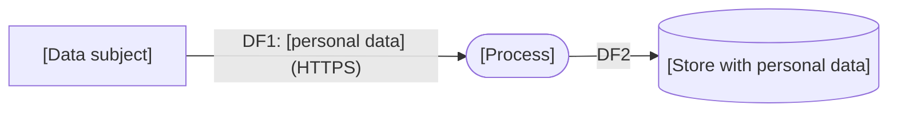

# Privacy threat model (LINDDUN) — [System name]

| | |
|---|---|
| **Model ID** | PTM-[000] |
| **System / version** | |
| **Controller / processor role** | [the organisation is controller / processor / joint controller] |
| **Privacy lead (role)** | |
| **Participants (roles)** | [security, product, legal/DPO, data engineering] |
| **Date / status** | [YYYY-MM-DD] · Draft / Reviewed / Approved |
| **DPIA required?** | Yes / No — rationale: |
| **Next review** | |

## 1. Personal data in scope

| Data category | Data subjects | Source | Purpose(s) told to subjects | Legal basis | Retention | Stores / flows (DFD IDs) |
|---------------|---------------|--------|-----------------------------|-------------|-----------|---------------------------|
| | | | | | | |

Special categories or vulnerable subjects: [ ]
Automated decisions or profiling with significant effect: [ ]
Third parties receiving data: [ ]

## 2. DFD with personal-data flows highlighted

## 3. Privacy threats

| ID | Element | Category (L/I/N/D/D/U/N) | Threat | Affected subjects | L (1–5) | Severity for the individual (1–5) | Score | Strategy | Technique / requirement | Owner (role) | Status |
|----|---------|---------------------------|--------|-------------------|---------|-----------------------------------|-------|----------|-------------------------|--------------|--------|
| PT-01 | DF2 | Data disclosure | | | | | | Hide | | | Open |
| PT-02 | P1 | Linking | | | | | | Separate | | | |
| PT-03 | | Unawareness | | | | | | Inform | | | |

Strategies: Minimise · Separate · Abstract · Hide · Inform · Control · Enforce · Demonstrate.

## 4. Rights and transparency check

| Right / duty | Supported? | How | Gap |
|--------------|------------|-----|-----|
| Information at collection (incl. AI involvement) | | | |
| Access and export | | | |
| Rectification | | | |
| Erasure and retention limits | | | |
| Objection / opt-out of profiling | | | |
| Human review of automated decisions | | | |
| Processor contracts and transfers | | | |

## 5. Decisions and residual risk

| Threat ID | Decision | Residual score | Accepted by (role) | Review date |
|-----------|----------|----------------|--------------------|-------------|
| | | | | |

## 6. Hand-over

* Privacy / legal: [DPIA reference]
* Engineering: [backlog items]
* AI governance (if applicable): [impact assessment reference, ISO/IEC 42001 clause 6.1.4]

| Role | Decision | Date |
|------|----------|------|
| Privacy lead | | |
| System owner | | |

*Template released under the MIT License by the threat-modeling-toolkit project. Not legal advice.*
