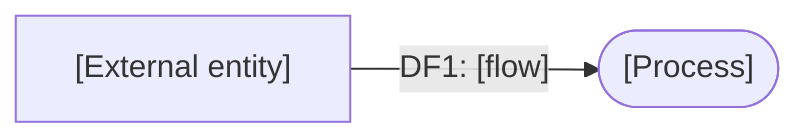
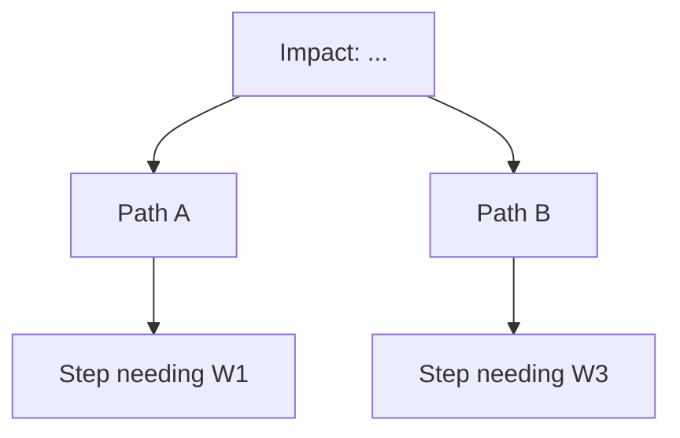

# Threat model (PASTA) — [System name]

| | |
|---|---|
| **Model ID** | TM-[000] |
| **System / version** | |
| **Risk owner (role)** | |
| **Participants (roles)** | |
| **Date / status** | [YYYY-MM-DD] · Draft / Reviewed / Approved |
| **Next review** | [date or event] |

## Stage 1 — Business and security objectives

| # | Business objective | Security / compliance objective | Impact if violated (1–5) | Impact criterion |
|---|--------------------|---------------------------------|--------------------------|------------------|
| O1 | | | | [financial / regulatory / operational / reputational / safety] |
| O2 | | | | |

Regulatory and contractual drivers: [ ]

## Stage 2 — Technical scope

| Item | In scope | Notes |
|------|----------|-------|
| Components | | |
| Data classes | | |
| Third parties / dependencies | | |
| Environments | | |
| Explicitly out of scope | | why |

## Stage 3 — Decomposition

DFD (see `docs/dfd-convention.md`):

Roles and permissions:

| Role | Can do | Cannot do | Authentication |
|------|--------|-----------|----------------|
| | | | |

Entry points:

| ID | Entry point | Protocol | Authenticated? | Data accepted |
|----|-------------|----------|----------------|---------------|
| | | | | |

## Stage 4 — Threat analysis

| Actor | Motivation | Capability | Access | Likely techniques (ATT&CK IDs) | Source of intel |
|-------|------------|------------|--------|-------------------------------|-----------------|
| | | | | | |

## Stage 5 — Vulnerability and weakness analysis

| ID | Component | Weakness | Source (scan / pen-test / STRIDE / review) | Severity | Exploitable by actor(s) |
|----|-----------|----------|--------------------------------------------|----------|-------------------------|
| W1 | | | | | |

## Stage 6 — Attack modelling

One block per scenario. Reference objectives (O), actors and weaknesses (W).

### Scenario S1 — [title]

Actor: [ ] · Target objective: [O1] · Precondition: [ ]

Existing controls on the path and evidence they work: [ ]
Detection coverage (which steps would the SOC see?): [ ]

## Stage 7 — Risk and impact analysis

| Scenario | Likelihood (1–5) | Impact (1–5) | Score | Rating | Countermeasures | Residual L | Residual I | Residual score | Decision | Owner (role) | Due |
|----------|------------------|--------------|-------|--------|-----------------|------------|------------|----------------|----------|--------------|-----|
| S1 | | | | | | | | | Mitigate / Accept / Transfer / Avoid | | |

Bands: Low 1–4 · Medium 5–9 · High 10–16 · Critical 17–25.

Risk-register entries created: [IDs]

## Sign-off

| Role | Decision | Date |
|------|----------|------|
| Risk owner | | |
| Security | | |

Appendix A — STRIDE table (`stride-threats.csv`) attached.

*Template released under the MIT License by the threat-modeling-toolkit project. Not legal advice.*
