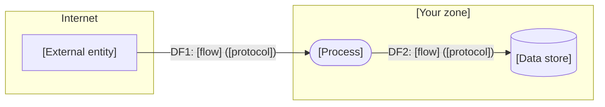

# Threat model (STRIDE) — [System name]

| | |
|---|---|
| **Model ID** | TM-[000] |
| **System / version** | [name, release or architecture version] |
| **System owner (role)** | [e.g. Head of Digital Platforms] |
| **Facilitator / participants (roles)** | [security, architect, lead developer, product owner] |
| **Date / status** | [YYYY-MM-DD] · Draft / Reviewed / Approved |
| **Trigger** | New system / significant change / periodic review / incident |
| **Next review** | [date or event] |

## 1. Scope and objectives

**In scope:** [components, environments, integrations]
**Out of scope and why:** [e.g. identity provider — covered by TM-012]
**Crown jewels:** [the data or capability whose loss hurts most]
**Compliance context:** [e.g. personal data of EU customers; PCI scope no; ISO 27001 certified scope yes]

Security objectives (3–6, business language):

1. [Customers must never see each other's invoices.]
2. [The portal must stay available during month-end peak.]
3. [...]

## 2. System decomposition

Data-flow diagram following [`docs/dfd-convention.md`](../docs/dfd-convention.md). Paste the Mermaid block generated by
`scripts/stride_from_dfd.py`, or draw it by hand with the same shapes.

Entry points (every way data enters): [UI, API, webhook, upload, queue, prompt]
Roles and permissions: [customer, agent, admin, service accounts]
Third parties and what they receive: [provider — data categories]

## 3. Threats

Start from the generated table (`stride-threats.csv`), then prune, merge and add in the workshop. Keep the generated
IDs so reviewers can trace decisions.

| Threat ID | Element | STRIDE | Threat (one sentence) | L (1–5) | I (1–5) | Score | Decision | Mitigation / requirement | ASVS 5.0 | ISO 27001 A | Owner (role) | Status |
|-----------|---------|--------|------------------------|---------|---------|-------|----------|--------------------------|----------|-------------|--------------|--------|
| P1-S1 | | S | | | | | Mitigate / Accept / Transfer / Avoid | | | | | Open |
| | | | | | | | | | | | | |

Scoring: Score = Likelihood × Impact; Low 1–4, Medium 5–9, High 10–16, Critical 17–25 (same bands as the
risk register so results can be copied across).

Threats added by the workshop that the generator cannot see (business logic, misuse of features, insider paths):

| Threat ID | Element | Threat | L | I | Score | Decision | Mitigation | Owner |
|-----------|---------|--------|---|---|-------|----------|------------|-------|
| WS-01 | | | | | | | | |

## 4. Mitigation plan

| # | Requirement (verifiable) | Covers threats | Verification method | Backlog ref | Due |
|---|--------------------------|----------------|---------------------|-------------|-----|
| 1 | [All admin endpoints require phishing-resistant MFA and are unreachable from the internet] | P5-S1, P5-E1 | Config check + pen-test | [ticket] | |

## 5. Accepted risks

| Threat ID | Why accepted | Accepted by (role) | Review date |
|-----------|--------------|--------------------|-------------|
| | | | |

## 6. Validation record

| Date | What was checked | Method | Result | Model updated? |
|------|------------------|--------|--------|----------------|
| | | | | |

## 7. Sign-off

| Role | Decision | Date |
|------|----------|------|
| System owner | | |
| Security | | |

*Template released under the MIT License by the threat-modeling-toolkit project. Not legal advice.*
